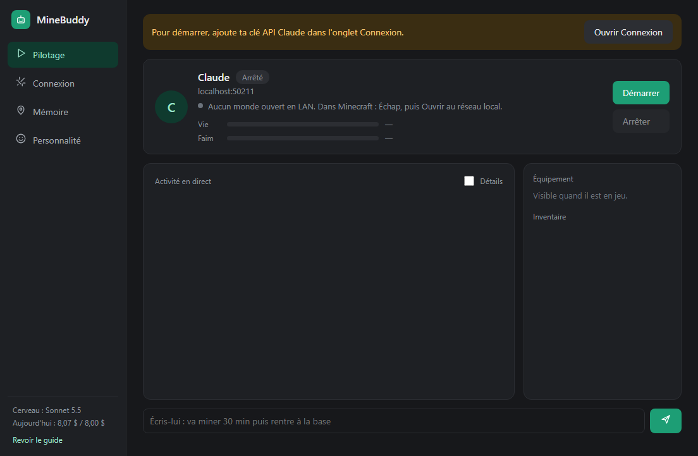
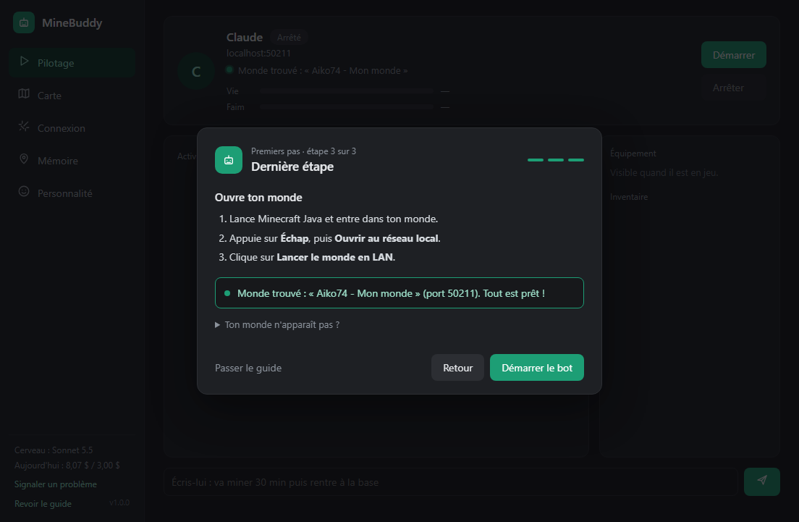
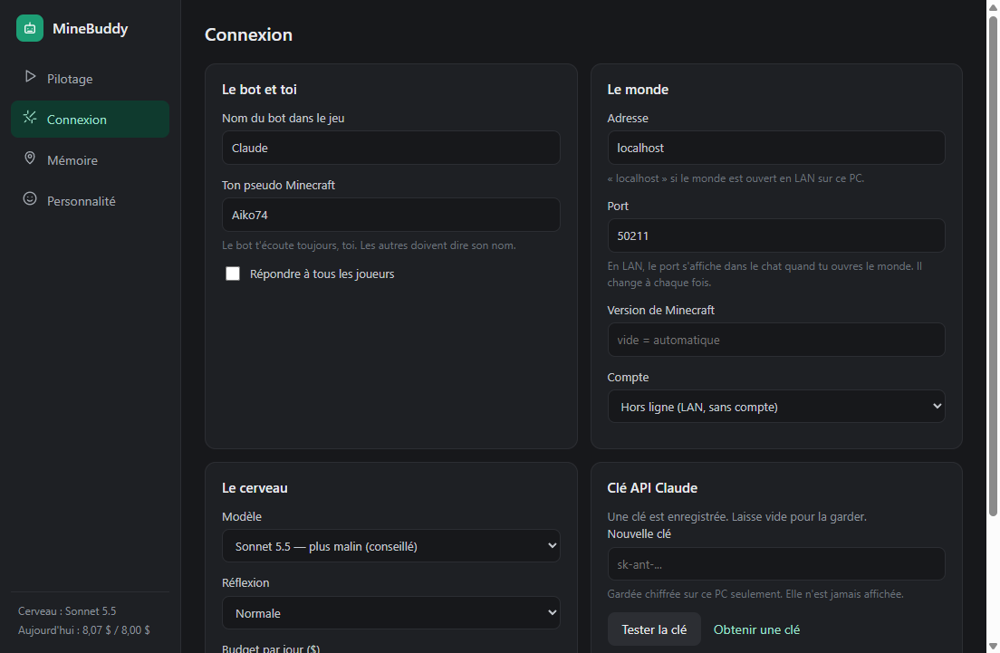
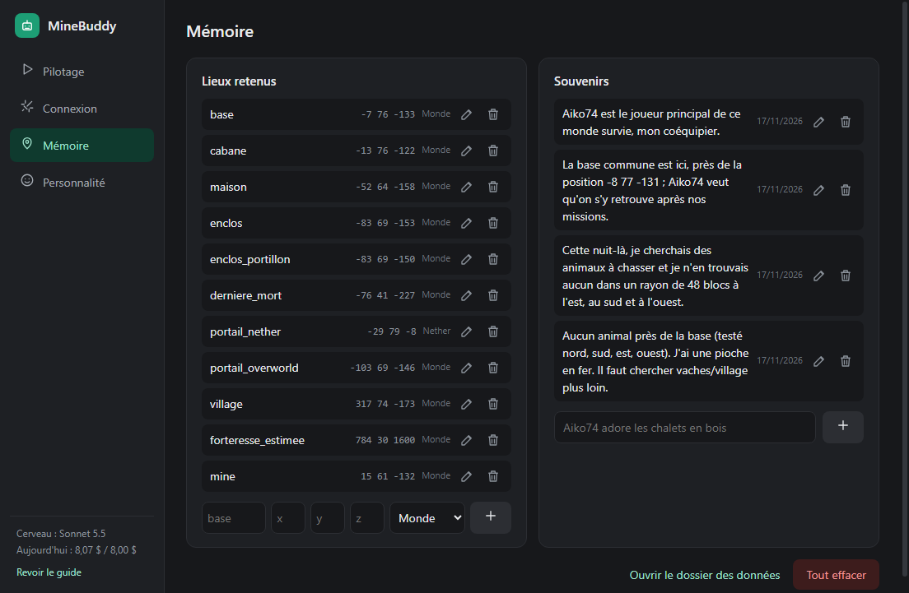
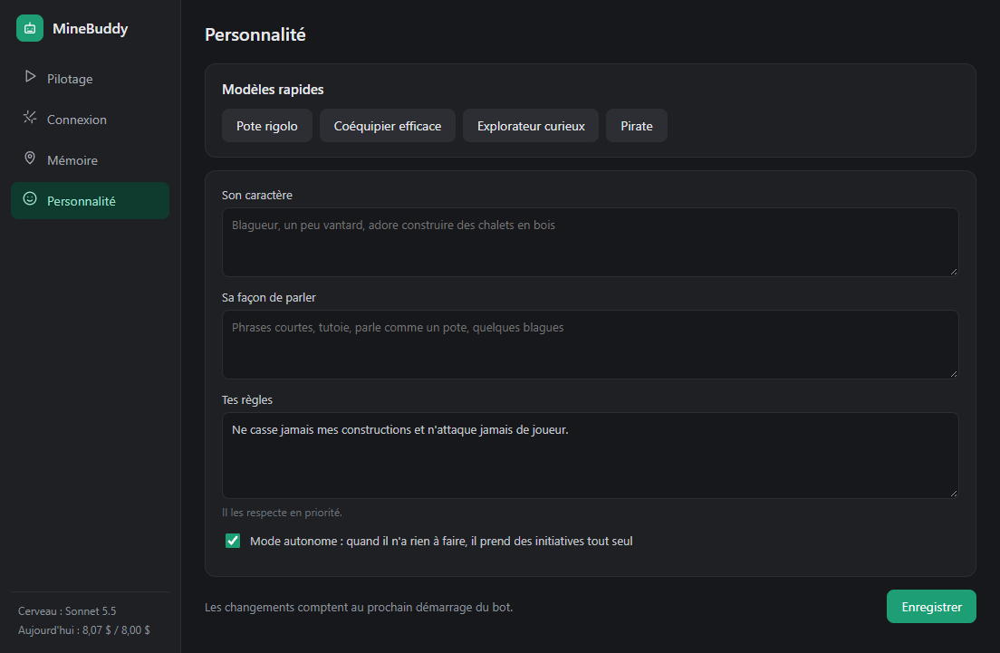

# MineBuddy

**Ton pote Minecraft piloté par l'IA Claude.** Tu lui parles normalement dans le chat du jeu, en français, et il comprend, réfléchit et joue avec toi. Pas de commandes à apprendre : « suis-moi », « va couper du bois », « fais-toi une pioche en pierre », « va miner 30 min puis on se retrouve à la base »… Il prend aussi des initiatives tout seul et se souvient de vos aventures.



## Ce qu'il sait faire

- **Jouer avec toi** : te suivre, te rejoindre, te donner des objets, te parler comme un pote (messages courts, en français).
- **Survivre** : manger, chasser et faire cuire la viande, mettre son armure, se défendre contre les monstres, dormir (il a même un lit portable), s'abriter la nuit, remonter respirer sous l'eau, nager jusqu'à la berge s'il est coincé dans l'eau.
- **Dormir avec toi** : quand tu te couches, il va dormir aussi, pour que la nuit passe.
- **Récolter et fabriquer** : bois, pierre, minerais, n'importe quel objet avec ou sans établi, four.
- **Construire** : une cabane, un chalet complet, aplanir un terrain, un enclos.
- **Une ferme** : attirer des vaches avec du blé, les enfermer, les faire se reproduire.
- **Miner en profondeur** : escalier jusqu'aux diamants, longues galeries, en évitant la lave et le vide.
- **Partir en mission tout seul** pendant un temps donné, puis revenir au rendez-vous.
- **Toute la progression du jeu** : obsidienne, portail du Nether, troc avec les piglins, échanges avec les villageois, yeux de l'Ender, portail de l'End, cristaux à l'arc… jusqu'à l'Ender Dragon (testé : il l'a tué).
- **Retenir** des lieux (base, mine, village…) et des souvenirs, même après un redémarrage.

Il ne casse **jamais** tes constructions et n'attaque **jamais** un joueur.

## Installer (Windows)

1. Va dans [Releases](../../releases) et télécharge `MineBuddy-Setup-1.0.0.exe`.
2. Lance-le. Windows peut afficher « Windows a protégé votre ordinateur » (l'appli n'est pas signée) : clique sur **Informations complémentaires**, puis **Exécuter quand même**.
3. Ouvre **MineBuddy**. Au premier lancement, un **guide en 3 étapes** t'accompagne : ta clé API, ton pseudo et le nom du bot, puis ton monde.

Ensuite, MineBuddy **se met à jour tout seul** : quand une nouvelle version sort, elle se télécharge en arrière-plan et s'installe à la fermeture (ou tout de suite avec le bouton « Redémarrer »).



## Ta clé API Claude

Le cerveau du bot, c'est Claude. Il te faut une clé (payante à l'usage) :

1. Crée un compte sur [console.anthropic.com](https://console.anthropic.com), ajoute un peu de crédit.
2. Va dans **API Keys** et crée une clé.
3. Colle-la dans la première étape du guide (ou plus tard dans l'onglet **Connexion**, puis **Tester la clé** et **Enregistrer**).

La clé reste chiffrée sur ton PC. Elle n'est jamais affichée ni envoyée ailleurs que chez Anthropic.

**Combien ça coûte ?** Ça dépend de combien il joue. Pendant nos tests avec Sonnet, une nuit de jeu autonome jusqu'au dragon a coûté environ 2,30 $ ; en le laissant tourner sans arrêt toute la journée, il a atteint 8 $. Tu fixes un **budget par jour** (3 $ par défaut) : une fois atteint, il passe tout seul sur Haiku, beaucoup moins cher. Et le réglage **Économie** (activé par défaut) confie les actions de routine à Haiku ; ton modèle garde les discussions avec toi, les événements (nuit, danger) et les coups durs.

## Jouer avec lui

1. Lance Minecraft (Java Edition) et ouvre ton monde.
2. **Échap** > **Ouvrir au réseau local** > **Lancer le monde en LAN**.
3. MineBuddy **repère ton monde tout seul** et remplit le port (plus besoin de le recopier, même s'il change à chaque fois).
4. Onglet **Pilotage** : **Démarrer**. Le bot rejoint ton monde et te dit salut.
5. Parle-lui dans le chat du jeu, ou dans la case en bas de l'onglet Pilotage.

Testé avec **Minecraft Java 26.1.2**. Pas besoin d'un deuxième compte : en LAN, il rejoint en mode hors ligne.

Au premier lancement, Windows peut demander d'**autoriser MineBuddy sur le réseau** : accepte (réseaux privés), c'est ce qui lui permet de trouver ton monde. Si ton monde n'apparaît pas, tu peux toujours taper le port à la main (il s'affiche dans le chat du jeu quand tu ouvres le monde).

**Il joue même fenêtre fermée** : si tu fermes MineBuddy pendant que le bot joue, il reste dans ton monde. Une petite icône près de l'horloge te permet de rouvrir l'appli, d'arrêter le bot ou de tout quitter. (Tu peux désactiver ça dans l'onglet Connexion.)

## Les onglets

| Onglet | Ce que tu y fais |
|---|---|
| **Pilotage** | Démarrer / arrêter le bot, voir sa vie, sa faim, sa position, ce qu'il fait en ce moment, sa mission, son équipement et son inventaire, et lui écrire. |
| **Carte** | Une carte vue de dessus autour du bot, en direct : le terrain, toi, le bot et ses lieux retenus (avec un bouton « Y aller »). |
| **Connexion** | Nom du bot, ton pseudo, les mondes LAN trouvés, adresse et port, le cerveau (Sonnet, Haiku, Opus), le budget, la clé API. |
| **Mémoire** | Ses lieux (avec coordonnées) et ses souvenirs : les voir, en ajouter, les modifier, les effacer. |
| **Personnalité** | Son caractère, sa façon de parler, tes règles, des modèles tout prêts (pote rigolo, pirate…), et le mode autonome. |





## À savoir

- Commence dans un **monde de test** : c'est une IA, elle peut faire des bêtises.
- L'eau et les nuits sans armure restent ses points faibles, même s'il s'en sort mieux : il nage jusqu'à la berge quand il est coincé, et il s'enterre tout seul à la tombée de la nuit s'il n'a presque pas d'armure. Il peut mourir comme un vrai joueur.
- Il n'est pas parfait sur les longs trajets en terrain très accidenté (jungle, falaises).
- Un problème ? Clique sur **Signaler un problème** en bas à gauche de l'appli : le rapport (sans ta clé) est copié, il ne reste qu'à le coller sur GitHub.

## Pour les développeurs

Il faut [Node.js](https://nodejs.org) 18 ou plus.

```bash
git clone https://github.com/Aiko74/minebuddy.git
cd minebuddy
npm install
npm start          # lance l'appli
npm run dist       # fabrique l'installateur dans dist/
npm run bot        # le bot seul en ligne de commande (réglages dans .env, voir .env.example)
```

Pour `npm run dist`, mets le projet dans un dossier au chemin court (par exemple `C:\minebuddy`) : l'outil qui fabrique l'installateur plante si le chemin dépasse 260 caractères.

**Publier une nouvelle version** : augmente `version` dans `package.json`, lance `npm run dist`, puis crée une Release GitHub (tag `v1.0.1` par exemple) avec ces 3 fichiers de `dist/` : `MineBuddy-Setup-x.y.z.exe`, `MineBuddy-Setup-x.y.z.exe.blockmap` et `latest.yml`. Les appli déjà installées la trouvent toutes seules (c'est `latest.yml` qui leur dit qu'elle existe).

| Fichier | Rôle |
|---|---|
| `index.js` | Connexion au monde, chat, lien avec l'appli |
| `brain.js` | Le cerveau : instructions de Claude, missions, initiatives, budget |
| `actions.js` | Toutes les actions du bot (récolter, construire, combattre, nager…) et ses réflexes |
| `memoire.js` | Lieux, souvenirs et réglages gardés sur le disque |
| `app/` | L'appli de bureau (Electron) : fenêtre, réglages, interface |

Construit avec [Mineflayer](https://github.com/PrismarineJS/mineflayer) et [l'API Claude](https://docs.anthropic.com).

## Licence

MIT : tu peux utiliser, modifier et repartager ce projet, en gardant la mention de l'auteur. Voir [LICENSE](LICENSE).

MineBuddy n'est pas affilié à Mojang, Microsoft ou Anthropic. Minecraft est une marque de Mojang/Microsoft.
